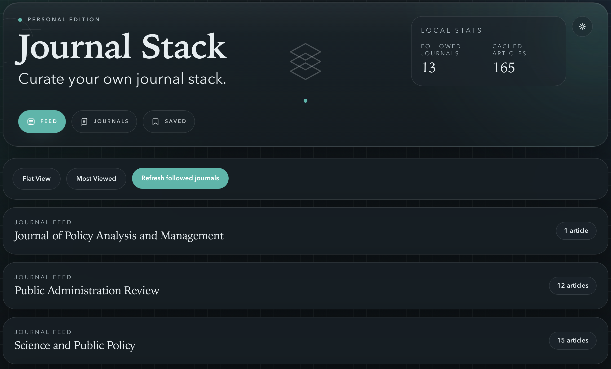
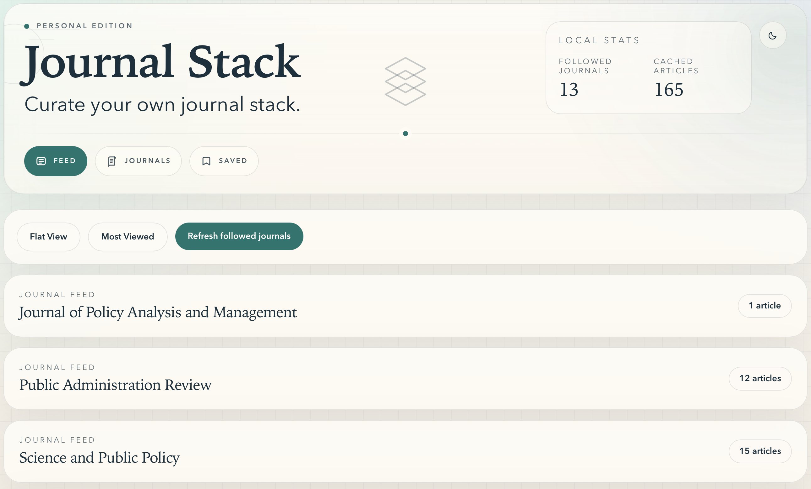

# Journal Stack

Journal Stack is a local-first app for keeping up with the journals you care about and getting to full text with less friction.

It is built for a simple workflow: follow journals, scan new articles, save what matters, and open either the publisher page or your institution-routed access link from one place.

## Screenshots

| Feed | Journals |
| --- | --- |
|  |  |

## What You Can Do

- Follow journals and keep a personal list of sources you care about
- Add journals by RSS feed URL or Crossref ISSN, with one-click metadata lookup
  that auto-fills the publisher, homepage, and ISSNs
- Edit or delete journals at any time
- Refresh followed journals to pull in newly available articles
- Browse your literature feed in either `Journal View` or `Article View`
- Sort by `Most Recent` or `Most Viewed`
- Open article details with title, authors, abstract, DOI, and journal metadata
- Choose between `Open journal link` and `Open via Institution`
- Set your own institution: pick your library from a short list or paste its
  link-resolver address (see [Your institution](#your-institution))
- Pick a colour theme, with a light/dark button in the header
  (see [Appearance](#appearance))
- Save articles into a lightweight reading queue
- Run it as a native desktop app (see [Desktop App](#desktop-app)) or in the browser
- Work in a clean, local-first interface without depending on a hosted service

## Main Views

### Feed

The feed is the main reading surface. It is designed for quickly scanning what is new across the journals you follow.

You can:

- group articles by journal
- switch to a flat chronological list (`Article View`)
- sort by recency or by tracked opens
- jump directly from discovery to the article page or access link

### Journals

The journals page is where you manage your source list.

You can:

- add a journal by title plus either an RSS feed URL or a Crossref ISSN
- use `Look up journal details` to auto-fill publisher, homepage, and ISSNs
- edit or delete an existing journal
- follow or unfollow a journal
- refresh a journal source on demand

### Saved

The saved view acts as a lightweight reading queue for articles you want to return to later.

### Settings

Appearance and your institution live under Settings:

- **macOS app:** **Journal Stack ▸ Settings** in the menu bar.
- **Browser and Windows app:** the gear button in the header.

## Why Use It

Journal Stack is useful if your current workflow looks something like:

- checking several journal sites separately
- clicking through multiple publisher pages
- bouncing through a library resolver to reach full text

Instead, this app gives you one place to monitor journals and two clear next actions on each article:

- go straight to the publisher page
- go through the institution-aware route

## Your institution

`Open via Institution` sends an article's details to your library's link
resolver, which signs you in and finds the full text. The first time you click
it, Journal Stack asks which library to use:

- **Pick from the list.** A short built-in list of university libraries
  (`data/institutions.json`).
- **My library isn't listed.** Paste your library's link-resolver address. To
  find it, search your library's website for "link resolver" or "OpenURL", or
  ask a librarian. Journal Stack appends the article's details to whatever you
  paste, in the standard OpenURL format.
- **I don't have an institution.** Hides the button.

Change it later under Settings: the gear button in the header, or
**Journal Stack ▸ Settings ▸ Institution…** in the macOS app's menu bar.

To add a library to the built-in list, add its name and resolver address to
`data/institutions.json`. The addresses there come from
[Zotero's OpenURL resolver directory](https://www.zotero.org/openurl_resolvers),
which lists several hundred more. Each built-in address answered a test lookup
when it was added; that shows the address is live, not that it reaches full
text for every article.

## Appearance

There are six colour themes in three families, each with a light and a dark
version:

| Family | Light | Dark |
| --- | --- | --- |
| Journal Stack | Journal Stack Light | Journal Stack Dark |
| [Flexoki](https://stephango.com/flexoki) | Flexoki Light | Flexoki Dark |
| [Modus](https://protesilaos.com/emacs/modus-themes) | Modus Operandi Tinted | Modus Vivendi Tinted |

- The sun/moon button in the header switches between the light and dark
  version of the family you are using.
- To change family, choose a theme under Settings ▸ Appearance.

A fresh install starts in Modus Operandi Tinted, so its dark mode is Modus
Vivendi Tinted. Your choice is remembered between launches.

To add a theme, give it an entry in `lib/themes.ts`, a matching
`:root[data-theme="…"]` block in `app/globals.css`, and a row in `THEMES` in
`desktop/src-tauri/src/lib.rs` (a test fails if the last one is missing).

## Run It Locally

Requires Node.js 22.13 or later (the migration script uses the built-in
`node:sqlite` module).

```bash
npm install
cp .env.example .env
npm run db:migrate
npm run db:seed
npm run dev
```

Then open `http://localhost:3000/feed`.

After pulling a newer version, run `npm run db:migrate` again: it applies any
new migrations and leaves your data alone. (The desktop app does this by itself
on every launch.)

## Desktop App

Journal Stack also runs as an ordinary desktop app on Windows and macOS: it
opens in its own window, with no terminal, no server to start and no browser
tab. Both versions are built from this one codebase with
[Tauri](https://tauri.app) and have every feature listed above.

There is no ready-made download yet; that is one of the
[next steps](#next-steps). You build the app once on your own computer, then
install it like any other app:

- [Install on Windows](#install-on-windows)
- [Install on macOS](#install-on-macos)

### What the desktop app does

- **Sets itself up.** The first launch creates your database and follows a
  starter set of journals, so the feed is ready to refresh straight away.
- **Keeps your data on your computer**, in a folder separate from the app
  (see [Where your data lives](#where-your-data-lives)). Updating or
  reinstalling the app does not touch it.
- **Opens articles in your normal browser.** `Open journal link` and
  `Open via Institution` hand the page to your default browser, where your
  library sign-in and saved passwords already work. The app window itself
  only ever shows Journal Stack.
- **Runs one copy at a time.** Launching it again brings the open window to
  the front.
- **Works offline for reading what you already have.** It needs the internet
  to refresh journals, look up journal details and open articles.

The two versions differ in a few places:

| | Windows | macOS |
| --- | --- | --- |
| What you install | An installer (`.msi` or setup `.exe`) | `Journal Stack.app`, dragged into Applications |
| Settings (appearance, institution) | Gear button in the header | **Journal Stack ▸ Settings** in the menu bar |
| Runs on | 64-bit Windows 10 or 11 | The kind of Mac it was built on (Apple Silicon or Intel) |
| Data folder | `%APPDATA%\com.journalstack.app` | `~/Library/Application Support/com.journalstack.app` |

### Install on Windows

1. Build the installers by following [Build on Windows](#build-on-windows).
2. Open `desktop\src-tauri\target\release\bundle\` and run either the `.msi`
   in `msi\` or the setup `.exe` in `nsis\`. They install the same app; you
   only need one.
3. Start **Journal Stack** from the Start menu.

Good to know:

- The app displays its pages with Microsoft's WebView2 component. Windows 11
  includes it; on Windows 10 the installer downloads it if it is missing.
- The installer is not code-signed. On the PC that built it this makes no
  difference, but if you copy it to another PC, Windows may warn that it comes
  from an unknown publisher. Choose **More info ▸ Run anyway**.
- To remove the app, use **Settings ▸ Apps ▸ Installed apps**.

### Install on macOS

1. Build the app by following [Build on macOS](#build-on-macos).
2. Open `desktop/src-tauri/target/release/bundle/macos/` and drag
   `Journal Stack.app` into your Applications folder. (It also runs from where
   it was built if you just double-click it.)
3. Open **Journal Stack** from Launchpad, Spotlight or the Applications folder.

Good to know:

- The app is not signed with an Apple Developer ID. It opens normally on the
  Mac that built it, but macOS will block a copy sent to a different Mac, so
  build it on each Mac you want to use it on.
- The first launch after building or updating can take a minute or so to show
  the feed. Later launches are immediate.
- To remove the app, drag it from Applications to the Trash.

### Updating

Get the newer code, build again, and install over the old copy:

- **Windows:** run the new installer. If it reports that the app is already
  installed, uninstall the old one first; if the uninstaller offers to delete
  application data, leave that unticked.
- **macOS:** drag the new `Journal Stack.app` into Applications and choose
  Replace.

Your journals, saved articles and institution carry over, because they live
in the data folder rather than in the app. The app updates its database by
itself the next time it starts.

### Where your data lives

Everything the desktop app stores is in one folder, separate from the
`prisma/dev.db` used when running from source:

- Windows: `%APPDATA%\com.journalstack.app\`
- macOS: `~/Library/Application Support/com.journalstack.app/`

| File | What it is |
| --- | --- |
| `dev.db` | Your journals, articles, saved list and institution. Copy this file to back up or move your data. |
| `settings.json` | macOS only: the colour theme you chose. |
| `startup.log` | What happened during the most recent launches. Look here first if the app will not start. |

Removing the app leaves this folder in place. To start again from scratch,
quit the app and delete the folder; the next launch sets up a fresh one.

### Build on Windows

Prerequisites (one-time):

- Rust with the MSVC toolchain:
  `rustup default stable-x86_64-pc-windows-msvc`
- Visual Studio C++ Build Tools ("Desktop development with C++" workload)
- Node.js 22.13 or later (the same binary is bundled into the app, and the
  first-run scripts need the built-in `node:sqlite` module)

From the repo root, produce the standalone server and copy it into the
desktop resources:

```powershell
npm install
npm run build

# Copy the standalone payload Tauri bundles (server.js + static + public).
# Wipe the assembled payload first — Copy-Item -Recurse nests a folder inside
# an existing same-named target, which silently breaks static asset serving.
Remove-Item -Recurse -Force desktop\resources\app -ErrorAction SilentlyContinue
New-Item -ItemType Directory -Force `
  desktop\resources\app\scripts, desktop\resources\app\public | Out-Null
Copy-Item -Recurse -Force .next\standalone\* desktop\resources\app\
Copy-Item -Recurse -Force .next\static       desktop\resources\app\.next\static
# public\ is optional (the repo ships without one).
if (Test-Path public) {
  Copy-Item -Recurse -Force public\* desktop\resources\app\public\
}

# Copy migrations, seed data, first-run scripts, and a Node binary for the sidecar
New-Item -ItemType Directory -Force desktop\resources\migrations, `
  desktop\resources\seed, desktop\resources\app\scripts | Out-Null
Copy-Item -Recurse -Force prisma\migrations\*        desktop\resources\migrations\
Copy-Item -Force data\journals.example.json          desktop\resources\seed\
Copy-Item -Force scripts\apply-migration.mjs         desktop\resources\app\scripts\
Copy-Item -Force desktop\scripts\seed.mjs            desktop\resources\app\scripts\
Copy-Item -Force (Get-Command node).Source `
  desktop\src-tauri\binaries\node-x86_64-pc-windows-msvc.exe
```

Then build the app:

```powershell
cd desktop
npm install
npm run tauri build
```

Installers are written to
`desktop/src-tauri/target/release/bundle/` (`.msi` and NSIS `.exe`).

### Build on macOS

Prerequisites (one-time):

- Xcode or the Xcode Command Line Tools (`xcode-select --install`)
- Rust, installed with [rustup](https://rustup.rs)
- Node.js 22.13 or later. Use the same Node for every step below: it is the
  binary that gets bundled, and `better-sqlite3` is compiled against it.

From the repo root:

```bash
npm install
npm run build

# Assemble the server payload, migrations, seed data and Node binary
# under desktop/ (replaces the PowerShell copy steps above).
node desktop/scripts/prepare-resources.mjs

cd desktop
npm install
npm run tauri build -- --bundles app
```

The app is written to
`desktop/src-tauri/target/release/bundle/macos/Journal Stack.app`.

`-- --bundles app` skips the `.dmg` disk image, which is only useful for
handing the app to someone else.

### How it works

- The desktop build keeps the full Next.js app intact and runs it as a bundled
  Node process on a private loopback port, chosen fresh at each launch. Nothing
  is exposed on the network. Source for the shell lives in
  [`desktop/`](./desktop).
- On every launch the app applies any new database migrations before showing
  the window.
- The build artifacts under `desktop/` (`node_modules`, `resources`,
  `src-tauri/target`, `src-tauri/binaries`) are gitignored and regenerated by
  the build steps above.

## Next Steps

Planned, in this order:

1. **Check the Windows build.** Rebuild and run the Windows app with the
   latest changes (colour themes, institution setting), which so far have only
   been built on macOS.
2. **Download links.** Publish ready-made installers on a GitHub Releases
   page, built automatically whenever a version is tagged, so nobody has to
   build the app to use it. The Windows installer will be unsigned at first,
   which means one "unknown publisher" warning on install.
3. **iPhone and iPad app.** A version of Journal Stack for iOS and iPadOS.
4. **A signed Mac app.** The iOS work needs an Apple Developer account, and
   the same account lets the Mac app be signed so a downloaded copy opens
   without warnings. Until then, any Mac download is unsigned and macOS asks
   for approval before opening it.

## Notes

- Journal Stack is a server-rendered app, not a static site.
- Data is stored locally: in `prisma/dev.db` when run from source, and in your
  app-data folder for the desktop app (see [Where your data lives](#where-your-data-lives)).
- GitHub is useful for syncing the code between machines, but not for hosting the full app on GitHub Pages in its current form.

## Acknowledgements

- Built through natural language prompting using `claude-fable-5.2` in Claude Code
